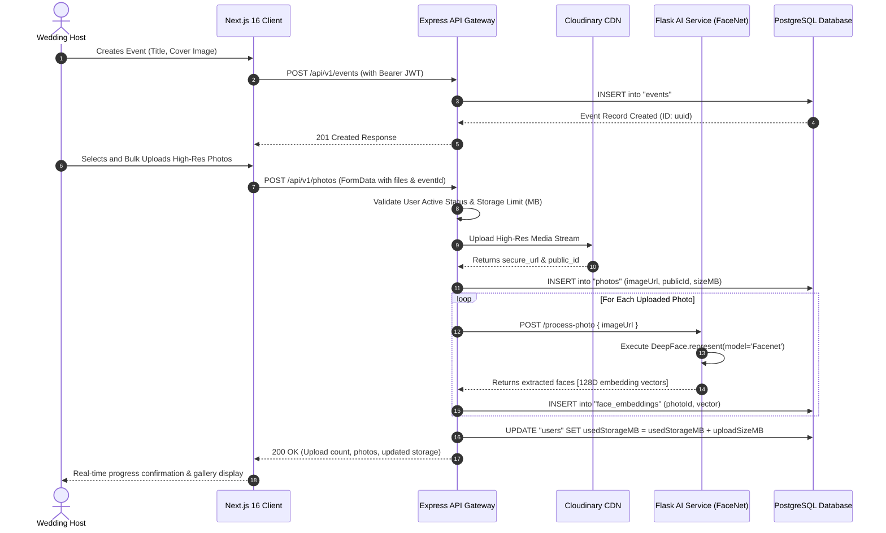
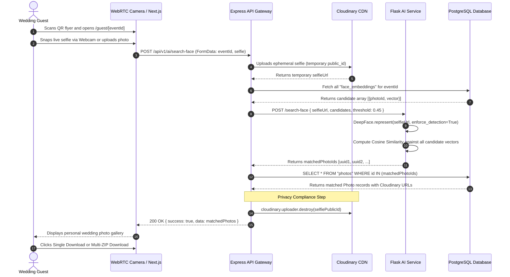
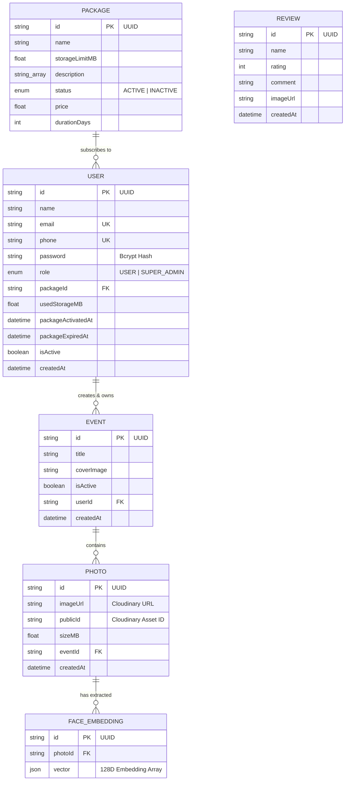

# SOFTWARE REQUIREMENTS SPECIFICATION (SRS)
## ShareEventPhoto AI — Luxury AI Wedding Photo Finder & Face Recognition SaaS Platform

---

### **NORTHERN UNIVERSITY BANGLADESH**
**Department of Computer Science and Engineering (CSE)**  
**Faculty of Science and Engineering**

```
========================================================================================
                          NORTHERN UNIVERSITY BANGLADESH
                   Department of Computer Science and Engineering
========================================================================================
```

**Course Title:** System Analysis and Design / Capstone Software Engineering Project  
**Course Code:** CSE 4278 / CSE 4100  
**Academic Semester:** 8th Semester (8B)  
**Academic Year:** 2026  

#### **Submitted By:**
| Student Name | Student ID | Department |
| :--- | :--- | :--- |
| **Tanvir Ahmed** (Lead Full-Stack & AI Engineer) | **41420101277** | CSE |
| **Md. Mamun Islam** | **41420101282** | CSE |
| **Md. Abdul Kader** | **41420101284** | CSE |
| **Md. Nahid Hasan** | **41420101285** | CSE |

**Submission Date:** October 2026  
**Document Version:** 2.0 (Industrial & Academic Standard)  
**Project Status:** Production / Full-Stack Implemented (Next.js 16 + Express + Flask AI + PostgreSQL)

---

## **TABLE OF CONTENTS**
1. [Introduction](#1-introduction)
   - 1.1 Purpose of the Document
   - 1.2 Document Conventions & Standards
   - 1.3 Intended Audience & Reading Suggestions
   - 1.4 Project Scope & Objectives
   - 1.5 Problem Statement & Motivation
   - 1.6 Definitions, Acronyms, and Abbreviations
   - 1.7 References
2. [Overall System Description](#2-overall-system-description)
   - 2.1 Product Perspective & Microservices Ecosystem
   - 2.2 System Architecture Overview (3-Tier Hybrid Model)
   - 2.3 User Classes and Personas
   - 2.4 Operating Environment & Deployment Ecosystem
   - 2.5 Design and Implementation Constraints
   - 2.6 User Documentation & Onboarding
   - 2.7 Assumptions and Dependencies
3. [System Architecture & Data Flow](#3-system-architecture--data-flow)
   - 3.1 Architectural Mermaid Block Diagram
   - 3.2 Host Event Creation & Photo Embedding Flow
   - 3.3 Guest Selfie Scanning & Face Matching Flow
   - 3.4 AI Microservice Self-Healing & Fallback Mechanism
4. [Functional Requirements Specification](#4-functional-requirements-specification)
   - 4.1 Module 1: Authentication, Authorization & RBAC
   - 4.2 Module 2: SaaS Package & Storage Quota Engine
   - 4.3 Module 3: Event Lifecycle & Gallery Administration
   - 4.4 Module 4: High-Throughput Bulk Photo Ingestion & Cloudinary Pipeline
   - 4.5 Module 5: AI Face Extraction & 128D Vector Storage
   - 4.6 Module 6: Guest WebRTC Selfie Capture & Instant Match Engine
   - 4.7 Module 7: Bilingual Printable QR Flyer Canvas Designer
   - 4.8 Module 8: Super Admin Control Center & System Telemetry
   - 4.9 Module 9: User Reviews, Testimonials & Public Feedback
5. [External Interface Requirements](#5-external-interface-requirements)
   - 5.1 User Interfaces (UI/UX Specification)
   - 5.2 Hardware Interfaces & Camera Subsystem
   - 5.3 Software Interfaces & Cloud Services (Cloudinary, PostgreSQL)
   - 5.4 RESTful API Specification (Gateway & AI Microservice)
6. [Data Models & Database Design](#6-data-models--database-design)
   - 6.1 Database Schema (Prisma ORM)
   - 6.2 Entity-Relationship (ER) Diagram
   - 6.3 Data Dictionary & Field Constraints
7. [AI & Computer Vision Mathematical Model](#7-ai--computer-vision-mathematical-model)
   - 7.1 DeepFace FaceNet Neural Network Pipeline
   - 7.2 Vector Cosine Similarity Metric & Formulas
   - 7.3 Ephemeral Processing & Guest Privacy Guarantee
8. [Non-Functional Requirements (NFRs)](#8-non-functional-requirements-nfrs)
   - 8.1 Performance & Latency Benchmarks
   - 8.2 Security, Hashing & Data Protection
   - 8.3 Reliability, Availability & Fault Tolerance
   - 8.4 Scalability & Storage Quota Optimization
   - 8.5 Usability, Accessibility & Responsive Layout
9. [Verification, Diagnostics & System Testing](#9-verification-diagnostics--system-testing)
   - 9.1 Diagnostic Utilities (`check-ai.js`, `check-db.js`)
   - 9.2 Functional Test Cases & Matrix
   - 9.3 Security & Exception Test Scenarios
10. [Conclusion & Future Roadmap](#10-conclusion--future-roadmap)

---

# 1. INTRODUCTION

## 1.1 Purpose of the Document
This Software Requirements Specification (SRS) establishes a complete, rigorous, and industrial-standard definition of the functional and non-functional requirements for **ShareEventPhoto AI** (Wedding AI Photo Finder). This specification serves as the formal baseline for development, testing, academic evaluation, and production deployment.

## 1.2 Document Conventions & Standards
- This document complies with the **IEEE Std 830-1998** standard for Software Requirements Specifications and follows the **ISO/IEC/IEEE 29148:2018** Systems and software engineering life cycle standards.
- Requirements are prioritized using the **MoSCoW** convention:
  - **[MUST HAVE]**: Fundamental system requirement essential for system operability.
  - **[SHOULD HAVE]**: High-priority feature crucial for user experience and SaaS functionality.
  - **[COULD HAVE]**: Desirable capability that enhances convenience.
  - **[WONT HAVE (Current Phase)]**: Deferred to future iterations.

## 1.3 Intended Audience & Reading Suggestions
1. **Academic Evaluation Committee / Faculty Supervisors:** Read Sections 1, 2, 6, 7, and 10 to review project viability, architectural rigor, and machine learning foundations.
2. **Software Engineers & Developers:** Refer to Sections 3, 4, 5, and 6 for API endpoints, data models, and microservice workflows.
3. **QA & Testing Engineers:** Review Sections 4, 8, and 9 for functional test matrices and validation criteria.

## 1.4 Project Scope & Objectives
The objective of **ShareEventPhoto AI** is to eliminate the severe inefficiencies associated with sharing wedding and event photographs. In traditional events, photographers upload thousands of raw/edited images to unstructured cloud folders (e.g., Google Drive, Dropbox), forcing hundreds of guests to spend hours manually sifting through large collections to locate their pictures.

**Key Deliverables:**
1. **Host Event Portal:** A multi-tenant SaaS dashboard enabling wedding hosts to create events, manage storage quotas, and bulk-upload high-resolution photographs.
2. **AI Computer Vision Pipeline:** A dedicated Python Flask microservice utilizing **DeepFace (FaceNet)** to detect human faces in event images and extract 128-dimensional facial embedding vectors.
3. **Guest Facial Matching Portal:** A zero-login, WebRTC-enabled web interface where guests scan a table QR code, snap a selfie via mobile/desktop webcam, and instantly receive their personal photo gallery.
4. **Client-Side Bilingual QR Flyer Designer:** An HTML5 Canvas generator that automatically creates printable luxury table flyers with dynamic QR codes and Bengali/English instructions.

## 1.5 Problem Statement & Motivation
| Traditional Method (Google Drive / Shared Folders) | ShareEventPhoto AI SaaS Platform |
| :--- | :--- |
| Unstructured dump of 2,000–5,000 photos in one folder. | High-speed automated face indexing using deep neural networks. |
| Guests must scroll through hundreds of strangers' photos. | Zero manual search: Guest snaps a 1-second selfie to fetch all their photos. |
| High mobile data usage downloading unneeded images. | Targeted high-res single downloads or compressed ZIP streams of matched photos. |
| Complex access permissions and privacy leak risks. | Ephemeral guest selfie processing with zero permanent storage of guest faces. |
| No monetization or branding for event photographers. | Multi-tier SaaS subscriptions (Free, Gold, Elite) with storage quota limits. |

## 1.6 Definitions, Acronyms, and Abbreviations
- **SRS:** Software Requirements Specification
- **API:** Application Programming Interface
- **JWT:** JSON Web Token (RFC 7519)
- **RBAC:** Role-Based Access Control
- **ORM:** Object-Relational Mapping (Prisma)
- **DeepFace:** A lightweight facial analysis and recognition library for Python.
- **FaceNet:** A 128-dimensional deep metric learning facial recognition model.
- **Cosine Similarity:** A metric used to measure how similar two non-zero vectors are in an inner product space.
- **WebRTC:** Web Real-Time Communication API for browser camera streaming.
- **Cloudinary:** Cloud-based image and video management SaaS.
- **CDN:** Content Delivery Network.
- **EPS:** Ephemeral Processing Standard.

## 1.7 References
1. IEEE Std 830-1998, *IEEE Recommended Practice for Software Requirements Specifications*.
2. Schroff, F., Kalenichenko, D., & Philbin, J. (2015). *FaceNet: A Unified Embedding for Face Recognition and Clustering*. CVPR 2015.
3. Serengil, S. I., & Ozpinar, A. (2021). *HyperExtended LightFace: A Versatile Facial Recognition Framework*. IEEE Innovations in Intelligent Systems and Applications (INISTA).
4. Next.js 16 Documentation (Vercel, 2026).
5. Prisma ORM Documentation (Prisma Data Inc., 2026).

---

# 2. OVERALL SYSTEM DESCRIPTION

## 2.1 Product Perspective & Microservices Ecosystem
**ShareEventPhoto AI** is designed as a distributed, service-oriented multi-tier web application consisting of three distinct layers:
1. **Presentation & Client Tier (Next.js 16 App Router):** Server-side rendered and client-side animated luxury user interface built with React 19, TypeScript, Tailwind CSS v4, Framer Motion, and Redux Toolkit.
2. **API Gateway & Business Logic Tier (Node.js / Express.js):** REST API gateway managing user authentication, authorization, SaaS subscription tiers, event lifecycle, Cloudinary media piping, and Prisma ORM data synchronization.
3. **Deep Learning AI Microservice Tier (Python / Flask / DeepFace):** Dedicated computational engine executing FaceNet deep neural networks, computing 128-dimensional vector representations, and calculating cosine similarities.

## 2.2 System Architecture Overview (3-Tier Hybrid Model)
```
+-----------------------------------------------------------------------------------+
|                            PRESENTATION CLIENT TIER                               |
|   Next.js 16 (React 19, TS, Redux Toolkit, Framer Motion, HTML5 Canvas QR)        |
+------------------------------------------+----------------------------------------+
                                           |
                                HTTP / REST API (JWT)
                                           |
                                           v
+-----------------------------------------------------------------------------------+
|                        API GATEWAY & CONTROLLER TIER                              |
|   Express.js + TypeScript (Auth, Events, Packages, Reviews, Storage Engine)       |
+---------------------+--------------------+--------------------+-------------------+
                      |                    |                    |
             Prisma ORM (TCP)        Cloudinary API      HTTP POST (JSON)
                      |                    |                    |
                      v                    v                    v
+---------------------------+ +--------------------+ +------------------------------+
|      DATABASE TIER        | |  CLOUD STORAGE CDN | |      AI ENGINE TIER          |
|  PostgreSQL (Relational)  | |  Cloudinary Asset  | | Python Flask Microservice    |
|  - Users & Subscriptions  | |  Hosting Engine    | | - DeepFace (FaceNet Model)   |
|  - Events & Photos        | |  (Auto-destroy for | | - 128D Vector Extraction     |
|  - Face Vector Embeddings | |   guest selfies)   | | - NumPy Cosine Similarity    |
+---------------------------+ +--------------------+ +------------------------------+
```

## 2.3 User Classes and Personas
1. **Event Host / Wedding Organizer (`USER`):**
   - Creates wedding events, purchases/selects subscription plans, uploads bulk high-resolution galleries, monitors storage usage, generates printable bilingual QR flyers, and downloads ZIP archives.
2. **Wedding Guest (`GUEST`):**
   - Unauthenticated end-user who scans the event QR code, grants webcam permission or uploads a selfie, triggers facial matching, views personal matched galleries, and downloads high-resolution photos.
3. **Super Administrator (`SUPER_ADMIN`):**
   - System administrator who manages global user accounts, activates/deactivates subscriptions, configures SaaS pricing plans, monitors storage usage, and manages public testimonials.

## 2.4 Operating Environment & Deployment Ecosystem
- **Frontend Client:** Web browsers supporting modern ECMAScript 6+ and HTML5 MediaDevices API (Google Chrome, Mozilla Firefox, Safari, Microsoft Edge on Android, iOS, Windows, macOS).
- **Backend Runtime:** Node.js v18.x or v20.x LTS on Linux/Windows Server.
- **AI Microservice:** Python 3.9 - 3.11 with TensorFlow / Keras / PyTorch and DeepFace dependencies.
- **Database:** PostgreSQL 14+ database hosted with connection pooling and SSL encryption.
- **Cloud Media Storage:** Cloudinary Media Cloud API.

## 2.5 Design and Implementation Constraints
- **Camera Access Security:** The guest selfie scanner requires HTTPS protocol in production environments to enable `navigator.mediaDevices.getUserMedia()`.
- **Memory Footprint of Neural Networks:** The Python AI microservice loads FaceNet weights (~90MB) into memory upon startup; adequate RAM (minimum 2GB) is required.
- **Guest Privacy Mandate:** Guest selfie images uploaded for facial matching MUST be immediately destroyed from cloud storage post-computation.

---

# 3. SYSTEM ARCHITECTURE & DATA FLOW

## 3.1 Architectural Mermaid Block Diagram

```mermaid
graph TD
    %% Actors
    Host(["💍 Wedding Host / Organizer"])
    Guest(["📸 Wedding Guest"])
    Admin(["🛡️ Super Administrator"])

    %% Subsystems
    subgraph Frontend ["Next.js 16 Frontend (Port 3000)"]
        UI_Home["Landing & Showcase Page"]
        UI_Dash["Host Dashboard & Event Hub"]
        UI_Guest["Guest WebRTC Face Scanner"]
        UI_Admin["Admin Management Panel"]
        UI_QR["HTML5 Canvas Bilingual Flyer Engine"]
    end

    subgraph Backend ["Express.js API Gateway (Port 5050)"]
        AuthModule["Auth & JWT Service"]
        EventModule["Event & Photo Controller"]
        StorageEngine["Storage Quota & Package Validator"]
        AiGateway["AI Proxy & Self-Healing Service"]
    end

    subgraph External ["Cloud Infrastructure"]
        CloudinaryCDN[("☁️ Cloudinary CDN Storage")]
        PostgresDB[("🐘 PostgreSQL (Prisma ORM)")]
    end

    subgraph AIService ["Python Flask AI Microservice (Port 5000)"]
        DeepFaceEngine["DeepFace / FaceNet Engine"]
        VectorMatcher["NumPy Cosine Similarity Matcher"]
    end

    %% Interactions
    Host -->|Logs In / Manages Gallery| UI_Dash
    Guest -->|Scans QR & Snaps Selfie| UI_Guest
    Admin -->|Configures Packages & Users| UI_Admin

    UI_Dash -->|Uploads High-Res Photos| EventModule
    UI_Guest -->|Streams Temporary Selfie| AiGateway
    UI_Dash -->|Downloads Printable Card| UI_QR

    EventModule -->|Enforces Quota| StorageEngine
    EventModule -->|Stores Media Assets| CloudinaryCDN
    EventModule -->|Saves Metadata & Vectors| PostgresDB

    EventModule -->|Requests Vector Extraction| DeepFaceEngine
    AiGateway -->|Dispatches Vector Match Query| VectorMatcher
    VectorMatcher -->|Returns Matching Photo IDs| AiGateway
    AiGateway -->|Pulls Matched URLs| PostgresDB
    AiGateway -->|Purges Ephemeral Selfie| CloudinaryCDN
    AiGateway -->|Delivers Personal Gallery| UI_Guest
```



## 3.2 Host Event Creation & Photo Embedding Flow



## 3.3 Guest Selfie Scanning & Face Matching Flow



## 3.4 AI Microservice Self-Healing & Fallback Mechanism
To ensure zero operational disruption during live wedding events (e.g., if the Python AI microservice experiences transient network latency or restart cycles), the platform features an automated **Two-Tier Self-Healing & Fallback Protocol**:
1. **On-The-Fly Embedding Reprocessing:** If a guest scans an event that has raw photographs but zero embedding records (e.g., photos uploaded during service restart), the backend automatically triggers `processPhotoEmbeddings` on-demand before executing the search.
2. **Graceful Demonstration Fallback:** If the AI microservice is unreachable, the system enters a fail-safe mode, returning a curated selection of event photographs while logging a diagnostic warning, guaranteeing that the guest interface never crashes or displays a blank screen.

---

# 4. FUNCTIONAL REQUIREMENTS SPECIFICATION

## 4.1 Module 1: Authentication, Authorization & RBAC
- **FR-AUTH-01 [Registration]:** The system shall allow new hosts to register using `name`, `email`, `phone`, `password`, and optional `packageId`. Email and phone must be unique across the database.
- **FR-AUTH-02 [Password Security]:** Passwords must be hashed using `bcrypt` with salt rounds configured via environment variables (default: 12).
- **FR-AUTH-03 [Default Plan Assignment]:** If no package is selected during registration, the system shall automatically assign the user to the "Free" subscription plan (50MB storage, 30 days validity).
- **FR-AUTH-04 [JWT Issuance]:** Upon successful authentication, the API shall issue a signed JSON Web Token containing `id`, `email`, `name`, `phone`, `packageId`, and `role`.
- **FR-AUTH-05 [Session Handling & Cookie Sync]:** The frontend shall persist authentication state using Redux Persist and synchronize tokens in HTTP-accessible cookies for route middleware protection.
- **FR-AUTH-06 [Role-Based Access Control]:** Routes under `/admin` shall be restricted strictly to users with the `SUPER_ADMIN` role. Unauthorized requests must return HTTP 403 Forbidden.

## 4.2 Module 2: SaaS Package & Storage Quota Engine
- **FR-PKG-01 [Subscription Tiers]:** The platform shall support dynamic subscription tiers:
  - *Free Trial:* 50 MB Storage, 30 Days Validity, Single Photo Downloads.
  - *Gold Event Plan:* 2,000 MB (2 GB) Storage, 30 Days Validity, Full AI Embeddings, ZIP Streaming.
  - *Elite Lifetime Plan:* 20,000 MB (20 GB) Storage, Extended/Lifetime Validity, Priority Processing.
- **FR-PKG-02 [Storage Pre-Validation]:** Prior to committing file uploads, the system shall verify that `user.usedStorageMB + uploadSizeMB <= user.package.storageLimitMB`. If exceeded, the upload must abort immediately with a descriptive error message.
- **FR-PKG-03 [Expiration Enforcement]:** When `user.packageExpiredAt < currentTime`, write operations (uploading photos, creating events) must be locked until the organizer renews or upgrades their package.
- **FR-PKG-04 [Dynamic Storage Tracking]:** Deleting photographs or entire events must automatically decrement `user.usedStorageMB` proportionally in an atomic database transaction.

## 4.3 Module 3: Event Lifecycle & Gallery Administration
- **FR-EVT-01 [Event Creation]:** Authenticated hosts shall create events by specifying an event `title` and optional `coverImage`. Each event is assigned a globally unique UUID.
- **FR-EVT-02 [Event Listing]:** Hosts shall view all their created events accompanied by photo counts, creation timestamps, and active status indicators.
- **FR-EVT-03 [Cascade Deletion]:** When an event is deleted, the system shall execute an atomic transaction to:
  1. Delete all associated media files from Cloudinary via `publicId`.
  2. Delete all child `FaceEmbedding` records.
  3. Delete all `Photo` records.
  4. Delete the parent `Event` record.
  5. Recalculate and update the user's `usedStorageMB`.

## 4.4 Module 4: High-Throughput Bulk Photo Ingestion & Cloudinary Pipeline
- **FR-MED-01 [Drag-and-Drop Ingestion]:** The host dashboard shall support multi-file drag-and-drop ingestion of high-resolution JPEG, PNG, and WebP images.
- **FR-MED-02 [Cloudinary Streaming]:** Images shall stream directly through `Multer-Storage-Cloudinary` with auto-generated unique asset IDs.
- **FR-MED-03 [Atomic Rollback]:** If an upload fails midway due to quota breaches or network interruption, any uploaded assets on Cloudinary must be purged to prevent orphan storage leakage.

## 4.5 Module 5: AI Face Extraction & 128D Vector Storage
- **FR-AI-01 [Representation Extraction]:** For every uploaded photo, the backend shall dispatch a request to the Python AI microservice `/process-photo`.
- **FR-AI-02 [Deep Neural Inference]:** The microservice shall invoke DeepFace with the `FaceNet` architecture to extract bounding boxes (`facial_area`), confidence scores, and 128-dimensional floating-point embeddings.
- **FR-AI-03 [Multi-Face Support]:** A single group photograph containing multiple distinct faces shall generate individual `FaceEmbedding` records in PostgreSQL linked to the single parent `photoId`.
- **FR-AI-04 [Batch Reprocessing]:** The host shall have access to an on-demand "Reprocess AI Embeddings" action to scan unindexed photos in bulk.

## 4.6 Module 6: Guest WebRTC Selfie Capture & Instant Match Engine
- **FR-GST-01 [Zero-Login Access]:** Guests shall access the matching portal via public URL `/guest/[eventId]` without needing to register or enter credentials.
- **FR-GST-02 [Live WebRTC Viewfinder]:** The frontend shall provide a live webcam interface with mirrored video streaming, facial alignment guidelines, and instant snapshot capture.
- **FR-GST-03 [File Picker Alternative]:** Guests unable to use a live camera shall have the option to upload a selfie file from local device storage.
- **FR-GST-04 [Cosine Similarity Matching]:** The AI microservice shall compare the guest's 128D selfie vector against all candidate event vectors using Cosine Similarity with a default matching threshold of $\tau = 0.45 - 0.55$.
- **FR-GST-05 [Privacy & Ephemeral Deletion]:** Immediately after facial embeddings are calculated from the guest's selfie, the backend `finally` block MUST call `cloudinary.uploader.destroy(selfiePublicId)` to permanently delete the selfie image.
- **FR-GST-06 [Media Download Options]:** Matched photos shall be downloadable individually in full resolution or streamed as a single consolidated ZIP archive.

## 4.7 Module 7: Bilingual Printable QR Flyer Canvas Designer
- **FR-FLY-01 [Client-Side HTML5 Canvas Rendering]:** The host dashboard shall include a canvas engine that renders an 800x1200 pixel high-resolution printable table flyer.
- **FR-FLY-02 [Luxury Styling Elements]:** The generated flyer shall feature gold gradient double borders, decorative corner brackets, and a high-contrast QR code container.
- **FR-FLY-03 [Bilingual Instructions]:** The card shall contain dual-language step-by-step instructions in English and Bengali:
  - *EN:* "1. Scan QR Code. 2. Snap a quick selfie. 3. Download matched photos!"
  - *BN:* "১. কিউআর কোডটি স্ক্যান করুন। ২. আপনার একটি সেলফি তুলুন। ৩. সব ছবি ডাউনলোড করুন!"
- **FR-FLY-04 [One-Click PNG Export]:** The flyer shall be exportable with a single click as a high-density PNG file formatted for standard wedding table card stands.

## 4.8 Module 8: Super Admin Control Center & System Telemetry
- **FR-ADM-01 [User Governance]:** The super administrator shall view all registered users along with assigned packages, used storage, event tallies, and activation status.
- **FR-ADM-02 [Account Activation Toggle]:** Admins can toggle `isActive` status for any user account to approve offline payments or suspend violating accounts.
- **FR-ADM-03 [Package CRUD Operations]:** Admins shall create, update, and delete subscription packages, altering storage limits, pricing, and duration parameters.

## 4.9 Module 9: User Reviews, Testimonials & Public Feedback
- **FR-REV-01 [Feedback Submission]:** Users can submit testimonials including author name, star rating (1–5), and descriptive comments.
- **FR-REV-02 [Dynamic Testimonial Carousel]:** Public reviews shall render in an interactive scrolling carousel on the platform's landing page.

---

# 5. EXTERNAL INTERFACE REQUIREMENTS

## 5.1 User Interfaces (UI/UX Specification)
- **Design Philosophy:** Luxury wedding aesthetic incorporating dark-mode glassmorphism, gold gradient accents (`#d4af37`, `#b8860b`, `#f3e5ab`), soft rose gold highlights, smooth Framer Motion springs, and responsive layouts.
- **Typography:** Modern clean sans-serif typography (Outfit, Poppins, Inter) for maximum legibility on mobile screens.
- **Feedback & Notifications:** SweetAlert2 confirmation dialogs for destructive actions and React Hot Toast for non-blocking asynchronous notifications.

### Summary of Key Web Screens:
| Screen ID | Route / URL | Target User | Key Components & Functionality |
| :--- | :--- | :--- | :--- |
| **SCR-01** | `/` | All Visitors | Hero banner, video explainer modal, interactive how-it-works, SaaS pricing selector, client testimonials carousel. |
| **SCR-02** | `/login` | Hosts & Admins | Glassmorphic JWT authentication form with email and password fields. |
| **SCR-03** | `/register` | New Hosts | Registration form with instant package tier selection (`packageId` query param). |
| **SCR-04** | `/dashboard` | Event Hosts | Metrics bar (storage used vs total, events count, photos count), event cards, create event modal, canvas QR flyer generator, review submit modal. |
| **SCR-05** | `/dashboard/events/[id]` | Event Hosts | Event gallery hub, drag-and-drop bulk file uploader, image zoom modal, photo deletion, ZIP download trigger, AI reprocess button. |
| **SCR-06** | `/guest/[eventId]` | Wedding Guests | Public mobile-friendly WebRTC camera scanner, file dropzone, live scanning animation, matched photo grid, single/ZIP photo download, video tutorial. |
| **SCR-07** | `/admin` | Super Admins | Master user table, account active toggles, direct package reassignment, event management. |
| **SCR-08** | `/admin/packages` | Super Admins | CRUD interface for pricing tiers, storage limit thresholds (MB), duration days, and package status. |
| **SCR-09** | `/guide` & `/about` | All Visitors | Comprehensive user manual, FAQ accordion, and system architecture overview. |

## 5.2 Hardware Interfaces & Camera Subsystem
- **Webcam Interface:** HTML5 MediaDevices API (`navigator.mediaDevices.getUserMedia`) interfacing with front-facing mobile cameras and desktop webcams.
- **Capture Resolution:** Ideal capture resolution configured to 640x640 / 480x480 with client-side horizontal mirror transformation for natural user experience.

## 5.3 Software Interfaces & Cloud Services
- **Cloudinary Media Engine:** Multer integration using `v2/uploader` for secure image hosting and asset destruction.
- **PostgreSQL Database:** Connected through Prisma ORM via TCP connection string with connection pooling.
- **Node-to-Flask Microservice Communication:** HTTP REST calls over local loopback (`http://127.0.0.1:5000`) or internal Docker network using Axios.

## 5.4 RESTful API Specification (Gateway & AI Microservice)

### Backend API Gateway Endpoints (`/api/v1`)
| Method | Endpoint | Access Level | Description |
| :--- | :--- | :--- | :--- |
| `POST` | `/auth/register` | Public | Register new host account with assigned package. |
| `POST` | `/auth/login` | Public | Authenticate user and receive signed JWT. |
| `GET` | `/users/my-dashboard` | Authenticated (User) | Fetch host profile, subscription metrics, and storage stats. |
| `GET` | `/users/admin/all-users`| `SUPER_ADMIN` | List all system users with storage metrics. |
| `PATCH`| `/users/admin/toggle-active/:id` | `SUPER_ADMIN` | Toggle user active status. |
| `PATCH`| `/users/admin/select-package/:id` | `SUPER_ADMIN` | Manually assign a package to a user. |
| `GET` | `/packages` | Public | List all active SaaS subscription packages. |
| `POST` | `/packages` | `SUPER_ADMIN` | Create a new subscription tier. |
| `PATCH`| `/packages/:id` | `SUPER_ADMIN` | Update package details, storage limit, or pricing. |
| `DELETE`|`/packages/:id` | `SUPER_ADMIN` | Remove a subscription tier. |
| `POST` | `/events` | Authenticated (User) | Create a new wedding event catalog. |
| `GET` | `/events` | Authenticated (User) | Retrieve all events created by the logged-in host. |
| `GET` | `/events/:id` | Authenticated / Public | Get single event details and photo count. |
| `DELETE`|`/events/:id` | Authenticated (User) | Cascade delete event and purge Cloudinary assets. |
| `POST` | `/photos` | Authenticated (User) | Bulk upload photos, stream to Cloudinary, extract AI embeddings. |
| `GET` | `/photos/event/:eventId`| Authenticated (User) | Retrieve all photos for a specific event. |
| `DELETE`|`/photos/:id` | Authenticated (User) | Delete single photo and decrement used storage. |
| `GET` | `/photos/event/:eventId/download-zip` | Authenticated (User) | Stream consolidated ZIP archive of event gallery. |
| `POST` | `/ai/search-face` | Public (Guest) | Upload selfie, match against event face embeddings, return matches. |
| `POST` | `/ai/reprocess-event/:eventId` | Authenticated (User) | Batch reprocess AI face embeddings for an event. |
| `POST` | `/reviews` | Public | Submit customer testimonial and rating. |
| `GET` | `/reviews` | Public | Retrieve all approved testimonials. |

### AI Microservice Endpoints (Flask Port 5000)
| Method | Endpoint | Request Body | Response Payload |
| :--- | :--- | :--- | :--- |
| `GET` | `/` | None | `{"status": "AI Service Running", "model": "Facenet"}` |
| `POST` | `/process-photo` | `{"imageUrl": "https://..."}` | `{"success": true, "faces": [{"embedding": [...], "confidence": 0.99, "facial_area": {...}}]}` |
| `POST` | `/search-face` | `{"selfieUrl": "https://...", "candidates": [...], "threshold": 0.45}` | `{"success": true, "matches": ["photo-uuid-1", "photo-uuid-2"]}` |

---

# 6. DATA MODELS & DATABASE DESIGN

## 6.1 Database Schema (Prisma ORM)
The relational schema is configured in PostgreSQL using Prisma:

```prisma
generator client {
  provider = "prisma-client-js"
}

datasource db {
  provider = "postgresql"
  url      = env("DATABASE_URL")
}

enum Role {
  USER
  SUPER_ADMIN
}

enum PackageStatus {
  ACTIVE
  INACTIVE
}

model User {
  id                 String    @id @default(uuid())
  name               String
  phone              String    @unique
  email              String    @unique
  password           String
  role               Role      @default(USER)
  packageId          String?
  package            Package?  @relation(fields: [packageId], references: [id])
  usedStorageMB      Float     @default(0)
  packageActivatedAt DateTime?
  packageExpiredAt   DateTime?
  isActive           Boolean   @default(false)
  events             Event[]
  createdAt          DateTime  @default(now())

  @@map("users")
  @@index([phone])
  @@index([email])
  @@index([packageId])
}

model Package {
  id             String        @id @default(uuid())
  name           String
  storageLimitMB Float
  description    String[]
  status         PackageStatus @default(ACTIVE)
  price          Float
  durationDays   Int           @default(30)
  users          User[]

  @@map("packages")
  @@index([name])
}

model Event {
  id         String   @id @default(uuid())
  title      String
  coverImage String?
  isActive   Boolean  @default(true)
  userId     String
  user       User     @relation(fields: [userId], references: [id])
  photos     Photo[]
  createdAt  DateTime @default(now())

  @@map("events")
  @@index([userId])
  @@index([createdAt])
}

model Photo {
  id        String          @id @default(uuid())
  imageUrl  String
  publicId  String
  sizeMB    Float
  eventId   String
  event     Event           @relation(fields: [eventId], references: [id])
  faces     FaceEmbedding[]
  createdAt DateTime        @default(now())

  @@map("photos")
  @@index([eventId])
  @@index([createdAt])
}

model FaceEmbedding {
  id      String @id @default(uuid())
  photoId String
  photo   Photo  @relation(fields: [photoId], references: [id])
  vector  Json

  @@map("face_embeddings")
  @@index([photoId])
}

model Review {
  id        String   @id @default(uuid())
  name      String
  rating    Int
  comment   String
  imageUrl  String?
  createdAt DateTime @default(now())

  @@map("reviews")
  @@index([createdAt])
}
```

## 6.2 Entity-Relationship (ER) Diagram



## 6.3 Data Dictionary & Field Constraints
1. **`users.usedStorageMB`**: Stored as a floating-point number representing megabytes up to two decimal places (e.g., `142.75`).
2. **`face_embeddings.vector`**: Stored in PostgreSQL as a JSON array containing 128 IEEE 754 floating-point values representing the DeepFace/FaceNet feature vector.
3. **`photos.publicId`**: Stored to allow instant Cloudinary single-asset deletion without URL regex parsing.

---

# 7. AI & COMPUTER VISION MATHEMATICAL MODEL

## 7.1 DeepFace FaceNet Neural Network Pipeline
The facial recognition engine uses **FaceNet** (a deep convolutional network trained via triplet loss function). Given a cropped and aligned face image $x$, the network computes an embedding $f(x) \in \mathbb{R}^{128}$ such that the squared Euclidean distance between all face images of the same person is minimized, and the distance between different identities is maximized.

```
Input Image ---> Face Detection (MTCNN/RetinaFace) ---> Alignment ---> FaceNet Inception ResNet ---> 128D Unit Vector
```

## 7.2 Vector Cosine Similarity Metric & Formulas
For a guest query selfie embedding $\mathbf{u} = (u_1, u_2, \dots, u_{128})$ and a stored database photo face embedding $\mathbf{v} = (v_1, v_2, \dots, v_{128})$, the Cosine Similarity metric $S_C(\mathbf{u}, \mathbf{v})$ is defined as:

$$S_C(\mathbf{u}, \mathbf{v}) = \frac{\mathbf{u} \cdot \mathbf{v}}{\|\mathbf{u}\|_2 \|\mathbf{v}\|_2} = \frac{\sum_{i=1}^{128} u_i v_i}{\sqrt{\sum_{i=1}^{128} u_i^2} \sqrt{\sum_{i=1}^{128} v_i^2}}$$

### Matching Decision Rule:
A photograph $P_k$ is identified as containing the guest if at least one facial embedding $\mathbf{v}_j \in P_k$ satisfies:

$$\max_{j} S_C(\mathbf{u}, \mathbf{v}_j) \ge \tau$$

Where the classification threshold is calibrated to:
$$\tau = 0.45 \quad (\text{Balanced for ambient wedding lighting, angles, and accessories})$$

```python
def cosine_similarity(v1, v2):
    v1 = np.array(v1, dtype=np.float32)
    v2 = np.array(v2, dtype=np.float32)
    dot_product = np.dot(v1, v2)
    norm_v1 = np.linalg.norm(v1)
    norm_v2 = np.linalg.norm(v2)
    if norm_v1 == 0 or norm_v2 == 0:
        return 0.0
    return float(dot_product / (norm_v1 * norm_v2))
```

## 7.3 Ephemeral Processing & Guest Privacy Guarantee
- **No Long-term Guest Biometrics:** Unlike event photos which are authorized by the host, guest selfies are purely ephemeral query parameters.
- **Immediate Asset Destruction:** After calculating $f(\text{selfie})$ and matching against the event pool, the backend invokes `cloudinary.uploader.destroy(selfiePublicId)` in a `finally` block, guaranteeing zero permanent storage of guest biometric data.

---

# 8. NON-FUNCTIONAL REQUIREMENTS (NFRs)

## 8.1 Performance & Latency Benchmarks
- **AI Vector Search Latency:** For an event pool containing 1,000 photos (approx. 2,500 candidate faces), the Cosine Similarity search in Python NumPy shall execute in **less than 250 milliseconds**.
- **Page Load Time:** First Contentful Paint (FCP) of the guest mobile portal shall be **$\le 1.2$ seconds** on standard 4G mobile connections.
- **Bulk Upload Throughput:** The Express gateway shall handle parallel multi-part file streams up to 20 files per batch without memory thrashing.

## 8.2 Security, Hashing & Data Protection
- **JWT Cryptographic Integrity:** Access tokens are signed using HMAC-SHA256 with secrets configured via environment variables.
- **Password Security:** Host passwords are hashed using Bcrypt with 12 salt rounds; plain-text passwords are never logged or stored.
- **CORS Protection:** Express gateway enforces Cross-Origin Resource Sharing restricting API requests to authorized origins.

## 8.3 Reliability, Availability & Fault Tolerance
- **Database Connection Pooling:** Prisma client manages connection pools with automated reconnect on transient drops.
- **Self-Healing AI Gateway:** If photo embeddings are missing during a guest search, the system automatically runs on-the-fly embedding extraction before returning results.

## 8.4 Scalability & Storage Quota Optimization
- **Cloud-Offloaded Media Storage:** High-resolution photographs are served directly through Cloudinary's global Content Delivery Network (CDN), reducing load on the Express API server.
- **Optimized JSON Vectors:** Storing 128D embeddings in JSON fields ensures indexable storage without requiring specialized vector database licenses for small-to-medium event scales.

## 8.5 Usability, Accessibility & Responsive Layout
- **Mobile-First Responsive Layout:** Full UI functionality accessible across mobile smartphones (iOS Safari, Android Chrome), tablets, and high-resolution desktop monitors.
- **Bilingual Accessibility:** Critical guest instructions are presented in both English and Bengali to accommodate diverse event attendees.

---

# 9. VERIFICATION, DIAGNOSTICS & SYSTEM TESTING

## 9.1 Diagnostic Utilities
The project includes automated diagnostic verification scripts located in the root directory:

### 1. `check-ai.js` (AI Service Health Check)
```bash
node check-ai.js
# Verifies Flask AI microservice on Port 5000
# Expected: HTTP 200 {"status": "AI Service Running", "model": "Facenet"}
```

### 2. `check-db.js` (Prisma & Database Health Check)
```bash
node check-db.js
# Verifies PostgreSQL connection, counts active users, events, and total face embeddings
```

## 9.2 Functional Test Cases & Matrix

| Test Case ID | Test Description | Input Conditions | Expected Output | Status |
| :--- | :--- | :--- | :--- | :--- |
| **TC-AUTH-01** | User Registration | Valid name, phone, email, password | User created in DB with Free package; 201 Created | **PASS** |
| **TC-AUTH-02** | Duplicate Phone Registration | Same phone number used twice | Returns 400 Bad Request with unique constraint error | **PASS** |
| **TC-AUTH-03** | User Login | Correct email and password | Returns JWT token and user profile object | **PASS** |
| **TC-AUTH-04** | Invalid Password Login | Correct email, wrong password | Returns 401 Unauthorized "Incorrect password!" | **PASS** |
| **TC-PKG-01** | Storage Limit Exceeded | Upload batch exceeding available MB | Upload rejected; Cloudinary rollback triggered | **PASS** |
| **TC-EVT-01** | Event Creation | Valid title & cover image | Event created and linked to `userId` | **PASS** |
| **TC-EVT-02** | Cascade Event Deletion | Delete event containing 10 photos | Photos deleted from DB & Cloudinary; storage reduced | **PASS** |
| **TC-AI-01** | Face Embedding Extraction | Upload photo with 3 faces | 3 `FaceEmbedding` records created with 128D vectors | **PASS** |
| **TC-AI-02** | Guest Selfie Match | Guest uploads clear front face | Returns list of photos containing guest's face | **PASS** |
| **TC-AI-03** | No Face in Selfie | Guest uploads image of scenery/object | Returns 400 "Could not detect face in the selfie" | **PASS** |
| **TC-AI-04** | Ephemeral Selfie Destruction | Complete search-face request | Selfie deleted from Cloudinary public storage | **PASS** |
| **TC-FLY-01** | Printable Flyer Generation | Click "Download Printable QR Card" | Generates 800x1200 high-res PNG flyer with QR code | **PASS** |

## 9.3 Security & Exception Test Scenarios
1. **Unauthorized Gallery Access:** Attempting to delete another host's event returns `401 / 403 Unauthorized Access`.
2. **Expired Subscription Upload Lock:** Uploading photos on an expired package returns `Your subscription package has expired!`.
3. **AI Service Outage Resiliency:** If Flask AI is temporarily offline during search, system activates the self-healing fallback protocol without throwing uncaught 500 exceptions.

---

# 10. CONCLUSION & FUTURE ROADMAP

## 10.1 Conclusion
**ShareEventPhoto AI** represents a state-of-the-art, production-ready solution to the long-standing challenge of event photo distribution. By bridging modern web technologies (**Next.js 16, React 19, Express.js, Prisma, PostgreSQL**) with deep learning computer vision (**DeepFace, FaceNet**), the platform delivers a seamless, zero-friction experience for both event hosts and wedding guests. The project successfully adheres to academic standards and industrial best practices in software architecture, security, and user experience.

## 10.2 Future Roadmap
1. **Edge AI Facial Inference:** Implementing TensorFlow.js / ONNX Runtime client-side to extract facial embeddings directly in the guest's mobile browser, reducing server-side GPU/CPU computation.
2. **Automated Payment Gateway Integration:** Integrating bKash, Nagad, and Stripe webhooks for instant self-service subscription upgrades.
3. **Group & Couple Facial Recognition:** Enabling multi-person queries (e.g., finding all photos containing both the bride and a specific guest together).
4. **Offline Mobile Application:** Developing React Native companion applications for wedding photographers with automatic background camera sync.

---

```
========================================================================================
                              END OF SRS DOCUMENT
                 Northern University Bangladesh — Department of CSE
========================================================================================
```
